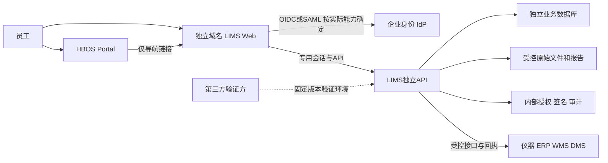

# HBOS–LIMS 身份、数据与验证边界

状态：**Proposed**。原则：HBOS仅入口/可选SSO，LIMS独立受控。

HBOS不可获得LIMS数据库/存储凭据或业务管理员权限。任何Portal提供的用户ID、姓名、角色声明都必须依据经过验证的身份协议及LIMS本地授权规则核实，不能直接信任来自页面的值。SSO登录成功也不能替代对某项受控记录的电子签名重新鉴别。

LIMS可直接访问，不要求先打开HBOS。但若共用IdP故障仍可能影响登录，须记录外部依赖并设计QA批准的应急流程；不能随意创建免认证后门。

对接口记录：协议和版本、环境、源身份、授权范围、请求/回执、幂等键、时间和错误、重试边界、变更控制。禁止HBOS或ERP直接SQL写入LIMS。
