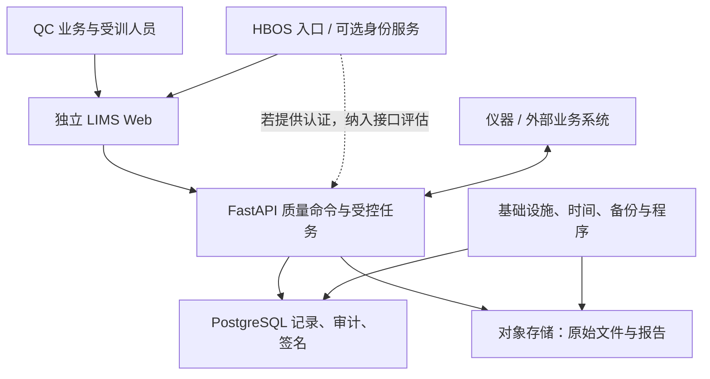

# SIA-HB-LIMS-001 初始系统影响评估

版本：0.1；日期：2026-11-20；状态：**PLANNING_DRAFT_NOT_APPROVED**。这是依据已知 URS 和选定架构形成的初始评估，尚无现场核实、具名企业评审或 QA 批准。

## 1. 当前判断

HB-Lims 预期管理药厂 QC 请验、取样/接收、分配、检验记录、复核/签名、报告及相关资源。其数据和判定将支持质量活动，因此**按有 GxP 影响的系统开展开发与验证规划**。这不是所有模块风险相同的结论，也不自动确定所有国家法规适用。

来源：原 URS-107/108/109、203、304、600–624、704/706、802、1201、2103–2109；LC-001/002；来源登记 S04 第 1、3、6–9、11 条、S01 原则/§4。

## 2. 已知事实、推断与待决定

| 事项 | 当前证据/判断 | 状态或下一责任 |
| --- | --- | --- |
| 系统用途 | QC 质量记录与检验业务；项目自研、第三方提供验证服务 | 已知规划；实际试点用途由 QC/QA 确认 |
| 规模 | 用户提供数百内部使用者；URS-103 至少 20 并发 | 不是已量测峰值；IT/QC 确定负载模型 |
| 应用架构 | 独立 LIMS、模块化单体；Next Web/薄 BFF、FastAPI/worker、独立 PG、S3 接口 | 已选技术方向；精确版本/产品待准入 |
| HBOS | 入口或可选 SSO，不共享业务数据库/质量权威 | 实际 SSO 提供者、故障/撤权合同待定 |
| 产品/厂区/市场 | 源 URS 主体与项目实施主体已有差异待决 | QA/Owner 确认；不能默认中国/美国/欧盟全部直接适用 |
| 记录主本 | 电子原始数据及纸电关系需逐类确定 | QA/QC 批准切换；纸质主本不授权丢弃电子原始数据 |
| 产品批放行 | 现阶段不得把 LIMS 报告批准视为自动产品放行 | 若未来包含该功能，单独确认法定职责/签名/流程 |
| 当前运行状态 | PR #1 是规范骨架，没有业务实现或现场验证证据 | NOT_IMPLEMENTED / NOT_RUN / QA NOT_GRANTED |

## 3. 系统与服务边界

| 对象 | GMP 影响/关键依赖 | 规划责任 | 需留证据 |
| --- | --- | --- | --- |
| Web/BFF/API/worker | 交互、质量命令、任务执行；后端统一授权/状态/审计 | 研发、系统 Owner | 设计、代码/配置、拒绝/故障测试 |
| PostgreSQL | 记录、版本、权限关联、签名/审计/事务 | 研发、IT | 配置/约束、恢复、迁移和访问控制 |
| 对象存储 | 原始文件、报告及必要元数据的可读性/完整性 | IT、研发 | 产品准入、对象版本、归档和一致恢复 |
| Redis / Celery | 临时状态、排队；重投递或丢失可能影响业务 | 研发、IT | 持久任务台账、幂等、对账、故障恢复 |
| 身份/时间/网络/主机 | 正确身份、权限撤回、时间可信、隔离与可用性 | IT、系统 Owner | 接口/基础设施确认、故障和变更责任 |
| 仪器/CDS/ERP 等 | 数据来源、单位、身份、回执与原始记录 | QC、研发、接口 Owner | 独立接口清单、协议、数据流、适用测试 |
| 人员和程序 | 培训、操作/维护、复核、事件、变更与批准 | QC/QA/IT/Owner | 程序、能力记录、职责和实际执行 |

边界图表示职责和依赖，未表示已实现。实际部署、安全域及每个接口要在 DS/CS 中细化。

## 4. 组件分类初判

| 组件/用途 | 分类方法与当前判断 | 注意事项 |
| --- | --- | --- |
| 自研检验流程、计算、审计/签名逻辑、接口代码 | 按 GAMP 定制软件类别 5 的生命周期思路规划 | 代码审查、单元/集成和预期用途测试；类别不等于全部功能高风险 |
| 方法/模板/工作流配置 | 按实际能力区分受控配置与定制脚本/代码 | 复杂表达式或可编程模板不能因叫“配置”降低控制 |
| 数据库、运行时、OS、网络等支持基础设施 | 按基础设施与实际配置/功能评估；通常参考类别 1 的思路 | 基础设施确认与项目使用测试仍需适用；具体分类由实际清单确定 |
| 外部现成或可配置产品 | 依实际使用、定制、供应方证据区分类别 3/4/5 组件 | 目前产品未全选定，不预填最终类别 |
| Git/CI/测试工具、开发 Agent | 生命周期工具按用途与风险评估 | 不自动归为类别 5 产品；直接修改质量记录的工具另行评估 |

这是一份分类初判，不是逐产品供应商准入结论。分类用于选择适当工作深度；不能拿来免除关键功能的测试。

## 5. 初始关键风险与后续评估

重点是身份/范围错误、原始数据被覆盖、审计缺失、错误签名版本、计算/标准错误、OOS 不当采用、重复/丢失接口数据、文件与元数据不一致、错误报告、恢复不完整、部署配置漂移和无证据质量使用。见 [风险与验证规划](lifecycle-plan.json)；所有风险目前 OPEN，残余风险 NOT_EVALUATED。

正式确认前需 QC/QA/Owner 决定用途/市场/主本/权限签名/方法与异常规则，IT 决定基础设施、产品支持、恢复/连续性和证据保管安排；已有 17 类参数继续使用同一 [待决登记](../../standards/validation-readiness/DECISIONS.md)。

**批准栏：未批准。** 真实系统 Owner、流程 Owner、IT、QA 的姓名/日期/结论和受控引用须由实际人员填写，本草案不代签。
